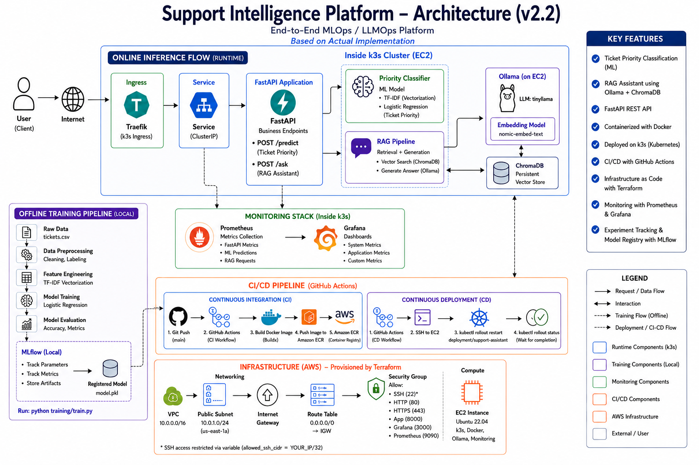
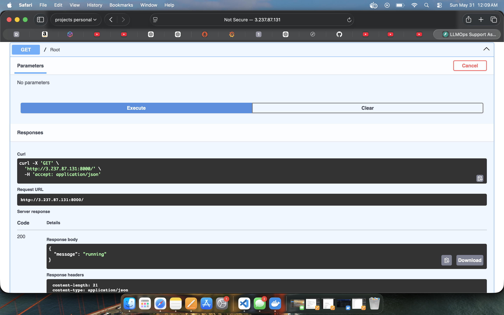
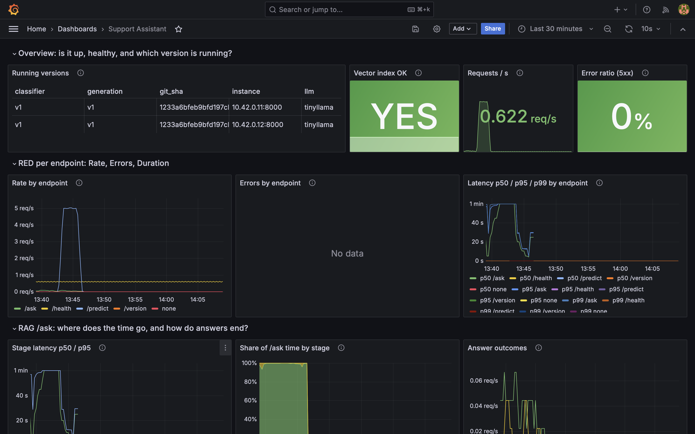
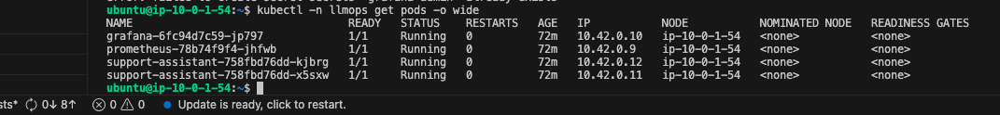

# Support Intelligence Platform

An end-to-end **MLOps** and **LLMOps** platform that combines machine learning–based support ticket classification with a Retrieval-Augmented Generation (RAG) assistant. The project demonstrates the complete machine learning lifecycle—from model training and experiment tracking to containerized deployment on Kubernetes with monitoring and CI/CD automation.

---

## Project Overview

Modern support teams receive a large volume of support requests every day. Quickly identifying high-priority tickets and providing relevant troubleshooting information can significantly improve response times and operational efficiency.

This project demonstrates how traditional machine learning and large language models can work together in a production-style environment.

The platform provides two core capabilities:

* **Ticket Priority Classification** — Predicts the priority of incoming support tickets using a Logistic Regression model trained on TF-IDF features.
* **RAG Support Assistant** — Answers user questions by retrieving relevant information from a vector database before generating responses using a local Large Language Model powered by Ollama.

Beyond the machine learning components, the project focuses on production engineering practices including infrastructure provisioning, containerization, Kubernetes deployment, experiment tracking, monitoring, and automated CI/CD pipelines.

The primary goal of this project is to demonstrate an end-to-end production-style MLOps workflow rather than achieving state-of-the-art machine learning accuracy.

---

## Key Features

* Machine Learning–based support ticket priority classification
* Retrieval-Augmented Generation (RAG) assistant
* Local LLM inference using Ollama (`tinyllama`)
* Local embedding generation using `nomic-embed-text`
* Persistent vector storage with ChromaDB
* Experiment tracking and model registry using MLflow
* FastAPI REST API for inference
* Dockerized application
* Kubernetes deployment using k3s
* Infrastructure provisioning with Terraform
* CI/CD pipeline using GitHub Actions
* Monitoring with Prometheus and Grafana

---

# System Architecture



# Application Screenshots

## FastAPI Swagger UI



The interactive API documentation automatically generated by FastAPI.

---

## MLflow Experiment Tracking


MLflow is used to track experiments, parameters, metrics, and trained model artifacts during the training pipeline.

---

## Grafana Dashboard



Grafana visualizes Prometheus metrics including HTTP requests, ML predictions, and RAG requests.

---

## Kubernetes Deployment



Application pods running inside the k3s cluster after deployment.

---

The platform consists of two independent workflows:

## Offline Training Pipeline

Historical support tickets are used to train a machine learning model independently from the deployed application.

Training workflow:

```
tickets.csv
      │
      ▼
Data Preprocessing
      │
      ▼
TF-IDF Vectorization
      │
      ▼
Logistic Regression
      │
      ▼
MLflow Experiment Tracking
      │
      ▼
Serialized Model
```

The trained model is exported and loaded by the FastAPI application during inference.

---

## Online Inference Pipeline

The application is deployed on Kubernetes and exposes two REST endpoints.

### POST /predict

Predicts ticket priority using the trained TF-IDF + Logistic Regression model.

```
User
   │
   ▼
FastAPI
   │
   ▼
TF-IDF
   │
   ▼
Logistic Regression
   │
   ▼
Prediction
```

### POST /ask

Implements a Retrieval-Augmented Generation workflow.

```
User
   │
   ▼
FastAPI
   │
   ▼
Embedding
(nomic-embed-text)
   │
   ▼
ChromaDB
   │
Retrieve Context
   │
   ▼
tinyllama (Ollama)
   │
   ▼
Generated Answer
```

---

# Technology Stack

| Category | Technologies |
|-----------|--------------|
| Programming Language | Python |
| Backend API | FastAPI |
| Machine Learning | scikit-learn, TF-IDF, Logistic Regression |
| LLMOps | Ollama, tinyllama, nomic-embed-text |
| Vector Database | ChromaDB |
| Experiment Tracking | MLflow |
| Containerization | Docker |
| Container Orchestration | Kubernetes (k3s), Traefik |
| Cloud Platform | AWS EC2, Amazon ECR |
| Infrastructure as Code | Terraform |
| Monitoring | Prometheus, Grafana |
| CI/CD | GitHub Actions |

---

# Repository Organization

| Directory | Responsibility |
|-----------|----------------|
| `app/` | FastAPI application and REST APIs |
| `training/` | Machine learning training pipeline and MLflow |
| `llm/` | RAG pipeline, embeddings, and vector database |
| `infra/` | Terraform infrastructure and Kubernetes manifests |

---

# Deployment & Operations

## Infrastructure

Terraform provisions the AWS infrastructure including:

- Virtual Private Cloud (VPC)
- Public Subnet
- Internet Gateway
- Route Table
- Security Group
- EC2 instance running Ubuntu 22.04 and k3s

---

## Containerization & Orchestration

The application is packaged as a Docker image and deployed on a lightweight Kubernetes (k3s) cluster.

Kubernetes manages:

- Application deployment
- Service discovery
- Ingress routing using Traefik
- Readiness probes
- Liveness probes
- Rolling updates

---

## CI/CD Pipeline

The project uses GitHub Actions to implement a two-stage Continuous Integration and Continuous Deployment (CI/CD) pipeline.

### Continuous Integration (CI)

On every push to the `main` branch, GitHub Actions:

1. Builds the Docker image using Docker Buildx.
2. Tags the Docker image.
3. Pushes the image to Amazon Elastic Container Registry (ECR).

### Continuous Deployment (CD)

After the CI workflow completes successfully:

1. A second GitHub Actions workflow is triggered.
2. The workflow connects securely to the EC2 instance using SSH.
3. Executes:

```bash
kubectl rollout restart deployment/support-assistant -n llmops
kubectl rollout status deployment/support-assistant -n llmops
```

4. Kubernetes performs a rolling deployment of the updated application.

---

## Monitoring

The application is instrumented using **prometheus-fastapi-instrumentator**, which automatically exposes HTTP metrics for the FastAPI service.

Prometheus scrapes these metrics every **5 seconds**, while Grafana visualizes operational dashboards.

The monitoring stack currently tracks:

### Application Metrics

- HTTP request count
- HTTP request latency
- HTTP response status codes
- In-progress requests

### Machine Learning Metrics

- Total ML predictions
- Prediction counts grouped by ticket priority

### LLM / RAG Metrics

- Total RAG requests

This monitoring setup provides visibility into API traffic, model usage, and RAG activity during runtime.
---

# Getting Started

## Prerequisites

- Python 3.11+
- Docker
- Ollama
- Kubernetes (k3s)
- Terraform
- AWS CLI

---

## Install Ollama Models

```bash
ollama pull tinyllama
ollama pull nomic-embed-text
```

---

## Clone Repository

```bash
git clone https://github.com/<your-username>/support-intelligence-platform.git

cd support-intelligence-platform
```

---

## Install Dependencies

```bash
pip install -r requirements.txt
```

---

## Run the Application

```bash
uvicorn app.main:app --reload
```

Application:

```
http://localhost:8000
```

Swagger UI:

```
http://localhost:8000/docs
```

---

# API Endpoints

| Method | Endpoint | Description |
|----------|----------|-------------|
| GET | `/` | Application status |
| GET | `/health` | Health check |
| POST | `/predict` | Predict ticket priority |
| POST | `/ask` | Ask questions using the RAG assistant |

---

# Future Improvements

Potential future enhancements include:

- Multi-label ticket classification (Priority, Department, Sentiment)
- Automated unit and integration testing in GitHub Actions
- Remote MLflow artifact storage
- Terraform remote state
- Managed Kubernetes deployment using Amazon EKS

---

# Lessons Learned

Building this project provided hands-on experience across the complete MLOps lifecycle.

Key takeaways include:

- Separating model training from inference services.
- Deploying machine learning workloads on Kubernetes.
- Provisioning cloud infrastructure using Terraform.
- Integrating traditional machine learning with Retrieval-Augmented Generation.
- Monitoring production services using Prometheus and Grafana.
- Automating container builds and deployments with GitHub Actions.

More importantly, this project reinforced that successful MLOps extends beyond building machine learning models—it also requires reproducibility, deployment automation, infrastructure management, observability, and operational reliability.

---

# License

This project is licensed under the MIT License.