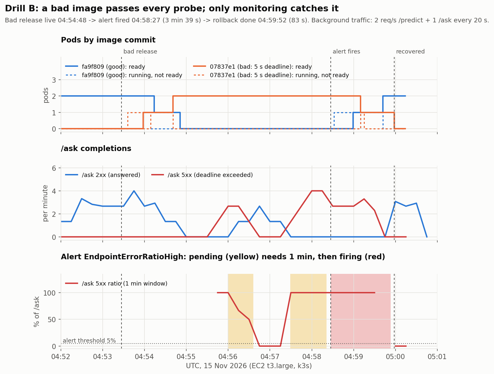
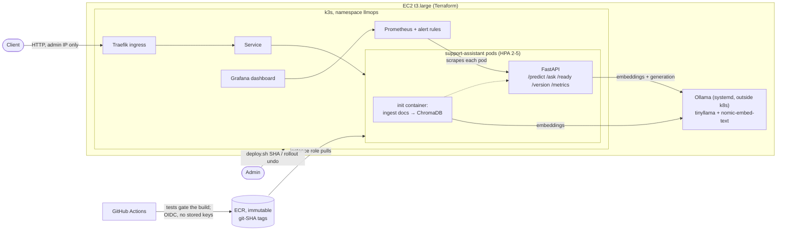

# LLMOps Support Assistant

A support API with two jobs:

- **`POST /predict`:** classifies a ticket's priority (TF-IDF + logistic regression).
- **`POST /ask`:** answers IT questions from a knowledge base, using retrieval-augmented generation with a local LLM.

It runs on k3s on AWS EC2, built and deployed through GitHub Actions and Terraform.

The models are deliberately small. The point of the project is everything around them: **measuring** quality, **versioning** every component, **monitoring** in production, **load testing** to find the real bottleneck, and **deploying safely**, with a rollback drill that caught a bug. Every number below was measured, and [`docs/RESULTS.md`](docs/RESULTS.md) records how, where and when.

## Key results

| Question | Answer (measured) |
|---|---|
| How good is the classifier? | Macro F1 **0.50** on 150 held-out synthetic tickets. It misses 33 of 45 outages; a char-n-gram v2 catches more outages but misroutes more medium tickets, so v1 stays the default ([§1](docs/RESULTS.md#1-ticket-classifier)) |
| Does retrieval find the right doc? | hit@2 **0.96**, MRR **0.97** on 25 golden questions ([§2](docs/RESULTS.md#2-retrieval)) |
| Are the answers right? | tinyllama is fully correct on **28%**; llama3 on **64%**, at about 2× the latency. Scored by an LLM judge calibrated 9/10 and checked against a human ([§3–5](docs/RESULTS.md#3-llm-judge-calibration)) |
| Where does the time go? | Generation is **~96%** of `/ask` time ([§6](docs/RESULTS.md#6-live-metrics-and-outage-drill-phase-3-local-stack)) |
| How much load can it take? | On a t3.large, `/predict` has p95 **8 ms at 100 req/s**. `/ask` is capped at **~0.07 answers/s** by the LLM on one CPU core, and extra users just queue. The autoscaler added pods but no capacity ([§7](docs/RESULTS.md#7-load-tests-bottleneck-and-slos-phase-4)) |
| What happens when a bad release ships? | A bad **config** was stopped by the readiness probe, with **0 user errors** and a **2 s** rollback. A bad **image** passed every probe; the alert fired after **3 min 39 s**, and the rollback took **83 s**. The drill also exposed a timeout that had never worked ([§9](docs/RESULTS.md#9-deployment-safety-and-rollback-drill-phase-5)) |



## Architecture



- **`/predict`** runs in-process: a versioned scikit-learn pipeline tracked in MLflow.
- **`/ask`** follows three steps:
  1. Embed the question and retrieve the top-k chunks from ChromaDB.
  2. Build the prompt from a versioned template.
  3. Have tinyllama answer, with a deadline on the whole answer.

  Each pod builds its own ChromaDB index at startup, and `/ready` refuses traffic if the index doesn't match the retrieval config.
- **Versions everywhere:** model, prompt, retrieval and generation settings live in committed files (`configs/`, `prompts/`). Every response and `GET /version` say exactly what's running.

Details: [architecture](docs/architecture.md) · [decisions (ADRs)](docs/adr/) · [runbook](docs/runbook.md) · [case study](docs/case-study.md) · [dashboard guide](docs/dashboard.md)

**Screenshots** (real deployments): [Grafana dashboard](docs/images/grafana-dashboard1.png) · [dashboard, lower panels](docs/images/grafana-dashboard2.png) · [RAG stage timing](docs/images/grafana-rag-stages.png) · [HPA scaling under load](docs/images/hpa-scaled.png) · [pods on k3s](docs/images/k8s-pods.png) · [`/version`](docs/images/version-endpoint.png) · [Swagger UI](docs/images/swagger-ui.png)

## Run it locally

Needs Python 3.11 (CI and the image use 3.11), Docker and [Ollama](https://ollama.com):

```bash
ollama pull tinyllama && ollama pull nomic-embed-text
make install            # runtime + dev dependencies
make test               # 46 tests, no Ollama needed
make ingest             # build the ChromaDB index from llm/docs/
docker compose up --build -d
```

- API: http://localhost:8000/docs
- Grafana: http://localhost:3000, dashboard "Support Assistant"
- Prometheus: http://localhost:9090, including `/alerts`

```bash
curl -s localhost:8000/predict -H 'content-type: application/json' -d '{"text":"Production database is down"}'
curl -s localhost:8000/ask -H 'content-type: application/json' -d '{"question":"How do I reset my password?"}'
curl -s localhost:8000/version
```

Evaluate: `make eval` (all; needs llama3 as the judge) or `make eval-classifier`. Compare versions: `make compare KIND=answers A=v1 B=gen-llama3`. Load test: `loadtest/run.sh local http://app:8000 llmops-support-assistant_default`.

## Deploy to AWS

The stack is built for a session and destroyed afterwards: about $0.08/hour for the t3.large.

```bash
cd infra/terraform && terraform apply -var "admin_cidr=$(curl -s https://checkip.amazonaws.com)/32"
#   VPC, security group (SSH + HTTP from your IP only), EC2 with IMDSv2, instance role
#   for ECR pulls, ECR repo, GitHub OIDC role for CI. user_data installs k3s + Ollama
#   and pulls the models (2 min 12 s on a clean boot).
infra/k8s/deploy.sh <git-sha> "reason"                       # on the node
kubectl -n llmops rollout undo deployment/support-assistant  # roll back
terraform destroy
```

CI (`.github/workflows/ci.yml`) runs ruff and pytest on every PR. On `main` it builds and pushes `:<git-sha>` to ECR, with no AWS keys stored in GitHub. Deploys run from the admin machine: the security group admits only the admin IP, so GitHub-hosted runners can't reach the node ([ADR 0007](docs/adr/0007-ci-oidc-and-admin-deploys.md)).

## Repository map

| Path | What |
|---|---|
| `app/` | FastAPI service: endpoints, RAG pipeline, classifier, metrics, index check |
| `configs/`, `prompts/` | Versioned classifier, retrieval and generation configs, and prompt templates |
| `training/` | Synthetic data generator, training with MLflow, model artifacts |
| `llm/` | Knowledge-base documents and the ingest script |
| `evaluation/` | Classifier, retrieval, LLM-judge and answer evaluations; golden set; results |
| `loadtest/` | k6 scripts, runner, and results per environment |
| `monitoring/` | Prometheus config, alert rules, Grafana dashboard (source for the k8s ConfigMaps) |
| `infra/terraform/`, `infra/k8s/` | AWS infrastructure and bootstrap; Kubernetes manifests and `deploy.sh` |
| `tools/` | Traffic generator, load-test report, drill recorder and charts |
| `docs/` | Results, architecture, ADRs, runbook, case study, status |

## Limitations

- **Synthetic data:** the tickets and knowledge base are synthetic (labelled as such), so real-world scores would likely be lower.
- **Small evaluation sets:** 150 test tickets and 30 golden questions.
- **Weak judge:** the LLM judge is small and under-scores correct answers.
- **Too slow for interactive chat:** `/ask` on CPU is about 13 s per answer. An honest SLO here is p95 ≤ 30 s.
- **One node:** there's no redundancy, and Ollama runs outside Kubernetes.

See [`docs/RESULTS.md`](docs/RESULTS.md#limitations).

## License

MIT
