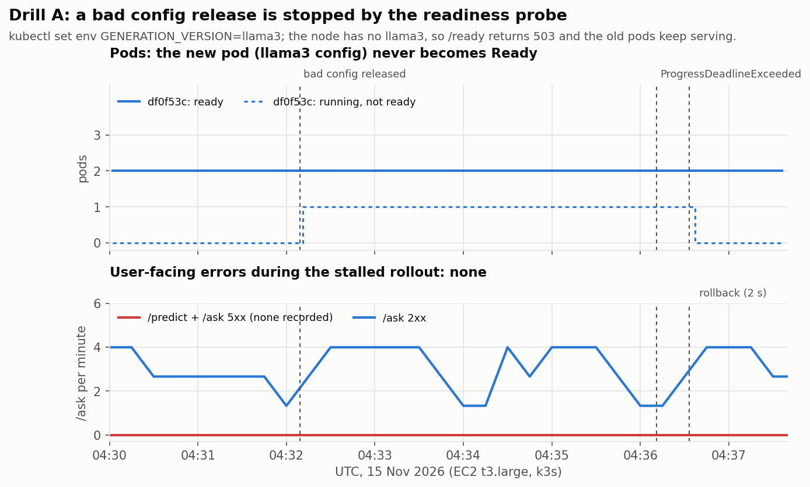
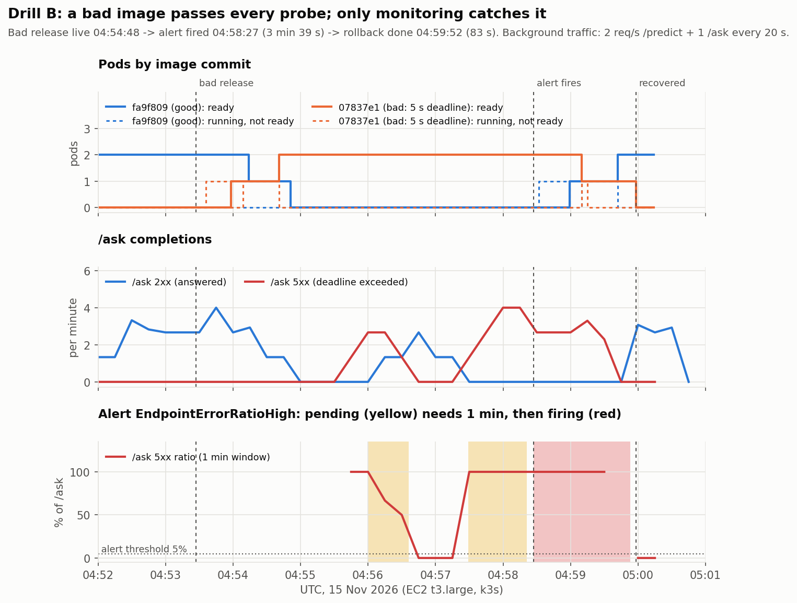

# Results

Only measured results go here, each with its method, date, and source file. Anything not yet measured is listed under **Not yet measured**. Mistakes found after publishing are recorded under **Corrections**, not silently edited away.

## Environment (all results so far)

| | |
|---|---|
| Date | 2026-11-12 |
| Hardware | Apple M1, 8 GB RAM (dev laptop) |
| OS / runtime | macOS 26.3.1, Python 3.9.6 (venv), Ollama 0.40.16 |
| Serving LLM (baseline) | `tinyllama`, temperature 0 (`configs/generation_v1.json`; what the EC2/k3s deployment serves) |
| Embeddings | `nomic-embed-text` |
| Judge model | `llama3` (8B), temperature 0, seed 42 |
| Baseline versions | classifier v1, prompt v1, retrieval v1 (chunks 500/50, top-k 2), generation v1 |

Every version is a committed file: `configs/classifier_*.json`, `configs/retrieval_*.json`, `configs/generation_*.json`, `prompts/rag_*.txt`. Env vars (`MODEL_VERSION`, `RETRIEVAL_VERSION`, `GENERATION_VERSION`, `PROMPT_VERSION`) only select a version. `GET /version` reports what a running instance is using.

## Reproducing

```bash
make eval LABEL=<name>                         # classifier, ingest, retrieval, judge calibration, answers
make eval-classifier MODEL_VERSION=v2          # one component, no Ollama needed
RETRIEVAL_VERSION=v2 make eval-answers LABEL=retrieval-v2
make compare KIND=answers A=v1 B=retrieval-v2  # side-by-side table
```

**Reproducibility check (Phase 1):** `make eval` re-run from a clean commit gave identical classifier and retrieval metrics, 30/30 identical answers and identical judge scores (this run used llama3 as the serving model; see Corrections). Only latency differed.

## 1. Ticket classifier

**Data (synthetic, labelled as such):** `training/generate_data.py`, seed 42. 600 training and 150 test tickets (30% high, 40% medium, 30% low). Test tickets use held-out sentence templates **and** held-out class-specific phrases. 5% of training labels are flipped to mimic labeller disagreement; test labels are clean.

| Version | Change | Accuracy | Macro F1 | High recall | Source |
|---|---|---|---|---|---|
| v0 (original) | 29 hand-written rows, vectorizer fitted before split (leak) | 0.353 | 0.288 | – | `classifier_v0-baseline.json` |
| **v1 (default)** | 600 synthetic rows, no leak; word unigrams | **0.493** | **0.499** | **0.267** | `classifier_v1.json` |
| v2 (experiment) | character n-grams (2–5) instead of words; nothing else changed | 0.467 | 0.478 | 0.400 | `classifier_v2.json` |

v1 per class: high P 0.279 / R 0.267 · medium P 0.462 / R 0.600 · low P 0.897 / R 0.578.
v1 confusion matrix (rows = true, cols = predicted: high / medium / low): high `[12, 33, 0]` · medium `[21, 36, 3]` · low `[10, 9, 26]`.

**v1 weakness:** 33 of 45 outages are labelled medium. Unigram TF-IDF can't link unseen phrasings ("hard down", "throwing 503s") to the training vocabulary ("completely down", "500 errors").

**v2 is a trade-off, not a win:** it catches 18 of 45 outages instead of 12 (high recall +0.13), but medium recall falls 0.600 → 0.433 and low precision 0.897 → 0.703. With 45 high tickets, recall has a standard error of about 0.07, so the gain is suggestive, not conclusive. **v1 stays the default.** Choosing v2 means accepting more misrouted medium tickets in exchange for fewer missed outages, which is a product decision. Both versions ship in the image (`MODEL_VERSION=v2`).

**Discarded result:** the first generator held out only templates, and v1 scored 1.0 on every class (shared phrases gave the label away). Fixed before any number was recorded.

## 2. Retrieval

**Method:** `evaluation/retrieval_eval.py` on `evaluation/golden_questions.jsonl`: 25 answerable questions (each mapped to one of 18 docs, worded differently from the doc) and 5 that should be refused. 18 docs → 36 chunks. Hit@k = any of the top-k chunks comes from the expected doc.

| Version | hit@1 | hit@2 | hit@3 | hit@5 | MRR@5 | Misses at serving k | Source |
|---|---|---|---|---|---|---|---|
| v1 (k=2) | 0.96 | 0.96 | 1.00 | 1.00 | 0.973 | 1 (q14) | `retrieval_v1.json` |
| v2 (k=3) | 0.96 | 0.96 | 1.00 | 1.00 | 0.973 | 0 | `retrieval_v2.json` |

- **Only miss at k=2:** q14 "access to the team's **shared inbox**" → retrieved `shared_drive_access.txt`; the email doc ranked 3rd.
- **No distance threshold can do the refusing:** top-1 L2 distance reaches 0.98 for answerable questions while the closest unanswerable one is 0.54.
- v2 uses the same index (the index manifest check passes; top-k is not part of the index identity).

## 3. LLM judge calibration

**Method:** `evaluation/judge_calibration.py`: 10 constructed cases with known labels (correct paraphrase, wrong number, partial, invented extra fact, wrong paragraph, off-topic, contradiction, number in words, ...), each using a real doc as context.

| Judge design | Grounded agreement | Correct agreement | Outcome |
|---|---|---|---|
| 1. One holistic prompt | – | – | Rejected: correct answers scored 0/0 |
| 2. "List unsupported claims" | 4/10 | 7/10 | Rejected: echoed the answer back |
| **3. Evidence quotes verified in code, fixed key facts** | **10/10** | **9/10** | In use |

The remaining miss ("five" vs "5") was scored too strictly. Source: `judge_calibration_llama3.json`.

**Human spot check (2026-11-12, re-checked 2026-11-13):** the project owner scored 10 tinyllama answers blind (`spot_check_v1.md`, scores in `spot_check_v1_scores.csv`). 4 of the 10 were declined answers, which a fixed rule scores (agreement 4/4 by construction). On the **6 answers the LLM judge scored, agreement is grounded 4/6 and correct 3/6.**

| Remaining disagreement | Cause |
|---|---|
| q24, q25 (correct) | **Judge too strict:** both key facts present, judge counted one |
| q08 (grounded) | **Judge too strict:** flagged "redirect loop", which is in the context |
| q14 (both) | Ambiguous: partially right, mixed with unrelated rules |

On first pass the owner also scored q04 and q05 leniently (q05 invents steps that contradict the context); after reviewing the disagreements they re-scored both, which then matched the judge. Recorded because spotting invented detail is hard for people too.

**What this means:** every clear judge error goes the same way: it **under-scores correct answers**. Tinyllama's correctness is therefore probably somewhat higher than reported; its flags for invented content held up. 10 calibration cases (9/10 on correctness) overstated agreement with a person, so calibration needs more multi-fact cases.

## 4. Answer quality: baseline (tinyllama, all v1)

**Method:** `evaluation/answer_eval.py`. The serving pipeline answers all 30 golden questions; the judge scores the 25 answerable ones. A refusal is detected in two ways: the **exact** sentence the prompt asks for (product format), or a decline **in any wording** (documented patterns, unit-tested).

| Metric | v1 (tinyllama) | Count |
|---|---|---|
| Fully correct | **0.28** | 7 / 25 |
| Partially correct | 0.24 | 6 / 25 |
| Wrong or declined | 0.48 | 12 / 25 |
| Grounded (refusals count as grounded) | 0.52 | 13 / 25 |
| **False refusals** (declined an answerable question) | **0.32** | 8 / 25 |
| Unanswerable questions declined | 1.00 | 5 / 5 |
| …using the exact refusal sentence | **0.00** | 0 / 5 |

Source: `answers_v1.json`.

**What goes wrong with tinyllama:**
- **Declines answerable questions:** 8/25, e.g. q01 "the context does not mention the length of a reset link" when it says 30 minutes.
- **Invents procedures:** q05 and q15 give multi-step instructions not in the context; q19 gets PG-504 wrong.
- **Never uses the required refusal sentence;** sometimes echoes the prompt instructions instead of answering (q11, q12).

## 5. Phase 2 comparisons (one component changed at a time)

All runs: same 30 golden questions, same judge and scorer (all re-judged after the refusal-detection change).

| Metric | **v1 baseline** (tinyllama, top-2) | retrieval v2 (top-3) | generation: llama3 |
|---|---|---|---|
| Fully correct | **0.28** | 0.08 | 0.64 |
| Mean correctness (0–2) | 0.80 | 0.60 | 1.56 |
| Grounded | 0.52 | 0.48 | 0.96 |
| False refusals | 0.32 | 0.28 | 0.04 |
| Unanswerable declined | 5/5 | **3/5** | 5/5 |
| Exact refusal sentence | 0/5 | 0/5 | 5/5 |
| Generation median (informal) | 1.1 s | 2.2 s | 2.3 s |
| Source | `answers_v1.json` | `answers_retrieval-v2.json` | `answers_gen-llama3.json` |

- **Retrieval v2: rejected.** It fixed the only retrieval miss, but end-to-end quality got worse: more context made tinyllama write longer, invented step lists, and it answered 2 questions it should have refused. A component metric improved while the product got worse.
- **llama3 instead of tinyllama:** far better on every quality metric, at about 2× the generation time on this laptop. Caveat: llama3 is also the judge here, and judges tend to favour their own outputs. Memory and latency on the small EC2 instance must be measured before considering it (Phase 4).

## 6. Live metrics and outage drill (Phase 3, local stack)

**Method:** `docker compose up` (app + Prometheus + Grafana) on the dev laptop; `tools/traffic.py` sending one request at a time (~3 `/predict` per `/ask`); values read from Prometheus. Not a load test. Panel guide: `docs/dashboard.md`.

| Metric (2026-11-13, tinyllama) | p50 | p95 | p99 |
|---|---|---|---|
| `/predict` latency | 12 ms | 24 ms | 25 ms |
| `/ask` latency | 1.03 s | 3.1 s | 4.6 s |
| Retrieval stage | 65 ms | 98 ms | |
| Generation stage | 1.02 s | 2.77 s | |

Generation is **≈ 96%** of `/ask` time. Percentiles are estimated from histogram buckets.

**Outage drill:** Ollama unreachable for 90 s under traffic. Detected on the dashboard in about 30 s (error ratio peaked at 26%, `rag_errors_total{stage="retrieval",error="ConnectionError"}`); 36 `/ask` requests got 503 while `/predict` stayed 100% successful; Prometheus `up` and `/health` stayed healthy throughout; each restart of the single container dropped in-flight requests (8 with no response).

## 7. Load tests, bottleneck and SLOs (Phase 4)

**Method:** k6 0.52.0 (pinned container), scripts in `loadtest/`, results in `loadtest/results/<env>/`, tables generated by `tools/loadtest_report.py`. Each load level is a separate run.
- `/predict`: fixed **arrival rate** (open model), 45 s per level. "Dropped" = requests k6 could not start because the server fell behind (saturation).
- `/ask`: fixed **concurrency** (closed model: each user waits for its answer), 180 s per level on EC2 (90 s locally).
- Mixed: 5 req/s `/predict` + one `/ask` every 30 s on EC2 (every 4 s locally) for 180 s.

**Environments:**
| | EC2 (deployment target) | Local (dev laptop) |
|---|---|---|
| Hardware | t3.large: **1 physical core / 2 threads** (Xeon 8259CL), 8 GB, CPU only | Apple M1, 8 GB; Ollama uses the GPU (Metal) |
| Stack | k3s v1.30.4, 2 app replicas (HPA 2–5), Traefik ingress, Ollama 0.40.16 on the node | docker compose, 1 app container |
| Load generator | k6 **on the same node**, through the ingress (shares the 2 threads) | k6 in Docker on the same Mac |
| Date | 2026-11-13 | 2026-11-13 |

### EC2 results (t3.large)

| `/predict` offered | Completed req/s | p50 | p95 | p99 | Errors | Dropped | Node CPU avg / max |
|---|---|---|---|---|---|---|---|
| 10 req/s | 10.0 | 4 ms | 5 ms | 8 ms | 0% | 0 | 10% / 24% |
| 50 req/s | 50.0 | 4 ms | 7 ms | 10 ms | 0% | 0 | 19% / 23% |
| 100 req/s | 100.0 | 4 ms | **8 ms** | 16 ms | 0% | 0 | 32% / 41% |
| 150 req/s | 150.0 | 4 ms | 22 ms | 182 ms | 0% | 0 | 51% / 82% |
| 200 req/s | 200.0 | 6 ms | 81 ms | 329 ms | 0% | 0 | 72% / 90% |
| 300 req/s | 277.6 | 1.67 s | **4.69 s** | 6.11 s | 0.6% | 1010 | **89% / 100%** |

| `/ask` concurrency | Completed req/s | p50 | p95 | p99 | Errors | Node CPU avg |
|---|---|---|---|---|---|---|
| 1 user | 0.07 | **12.7 s** | 26.8 s | 28.4 s | 0% | 54% |
| 2 users | 0.08 | 24.2 s | 38.5 s | 42.5 s | 0% | 54% |
| 4 users | 0.07 | **47.5 s** | 77.3 s | 87.1 s | 0% | 53% |

Mixed (5 req/s `/predict` + one `/ask` every 30 s): `/predict` p95 9 ms; `/ask` p50 17.7 s, p95 **25.3 s**; 0 errors.

### Local results (M1, for comparison)

`/predict` sustained 400 req/s (p95 3 ms) and saturated at 800 req/s offered (p95 1.23 s, 1357 dropped). `/ask`: 0.83 / 0.98 / 0.96 req/s with p50 1.3 s / 2.0 s / 4.3 s for 1 / 2 / 4 users. **The same `/ask` is ~10× slower on EC2** (12.7 s vs 1.3 s at one user), because the Mac runs the model on its GPU and the t3.large on one CPU core.

### Bottleneck analysis

1. **`/ask` is limited by the LLM, and requests queue.** Throughput stays at ~0.07 answers/s for 1, 2 and 4 users while latency grows in proportion to concurrency (12.7 s → 24.2 s → 47.5 s p50). Little's law agrees: 4 users / 0.072 req/s ≈ 55 s in the system (measured average 49 s). Generation is ~96–100% of `/ask` time (Grafana "Share of /ask time by stage", `docs/images/grafana-rag-stages.png`).
2. **Ollama uses about one of the two hyperthreads.** Node CPU stays at ~54% during `/ask` regardless of concurrency: requests are processed one at a time. More concurrency only lengthens the queue. *Hypothesis, not measured:* Ollama's thread and parallelism settings, not the instance's raw CPU, set the ceiling; tuning them is the next experiment.
3. **`/predict` is CPU-bound at ~150–200 req/s on this node.** p99 starts rising at 150 req/s and latency collapses at 300 req/s with node CPU at 89–100%. k6 shares the node, so the app alone would do somewhat better.
4. **The HPA scaled without adding capacity.** During the run it went 2 → 3 → 4 → 5 pods on CPU and back (`docs/images/hpa-scaled.png`). On a single node with one physical core, extra pods share the same CPU, and new pods' init containers call Ollama during the load. The app pods themselves used ~12 millicores during `/ask`; the CPU is consumed by Ollama, outside Kubernetes, so pod-CPU autoscaling cannot see the real bottleneck.

### SLO proposals (from the EC2 baseline)

Proposed targets the current system can meet with margin, over a 30-day window. **Proposed, not yet monitored with alerts.**

| Endpoint | SLI | Proposed SLO | Measured baseline | Error budget (30 d) |
|---|---|---|---|---|
| `/predict` | Availability (non-5xx) | **99.9%** | 0 errors up to 200 req/s | 43 min |
| `/predict` | Latency | **p95 ≤ 50 ms** at ≤ 100 req/s | p95 8 ms at 100 req/s | – |
| `/ask` | Availability (non-5xx) | **99%** (single Ollama, no redundancy) | 0 errors at 1–4 users | 7.2 h |
| `/ask` | Latency | **p95 ≤ 30 s** at ≤ 1 concurrent request | p95 26.8 s (1 user), 25.3 s (mixed) | – |

**What these SLOs reveal:** an honest `/ask` latency target on this hardware is 30 s, which is too slow for interactive support. Meeting something like p95 ≤ 5 s needs a different design (GPU instance, faster or smaller model, streaming the answer) and costs more. That's a product and cost decision, not a tuning fix. And because latency grows without limit as requests queue, `/ask` should **cap concurrent requests** (e.g. at 2, answering 503 + Retry-After beyond that) so it fails fast instead of making everyone wait. Proposed, not implemented.

### Infrastructure session timings (2026-11-13)

| Step | Duration |
|---|---|
| `terraform apply` (12 resources) | 39 s |
| Image build (amd64, emulated on M1) + push to ECR | 102 s |
| First-boot bootstrap | **Failed** at `ollama pull` (`$HOME` unset under cloud-init); fixed, re-run on the node in 45 s with packages cached. Clean first boot measured in Phase 5: 2 min 12 s (section 9) |
| `kubectl apply` → app ready (2 pods, init-container ingest) | 72 s |
| `terraform destroy` (12 resources) | 39 s |
| Whole AWS session | ~1 h 53 min (≈ $0.16 instance time) |

## 8. Latency (informal, not a benchmark)

Single sequential runs on the dev laptop, with other models loaded; **not** a load test. Retrieval median 0.02–0.14 s; generation median 1.1 s (tinyllama, top-2) to 2.3 s (llama3). Generation dominates `/ask` in every run. Proper p50/p95/p99 per endpoint is Phase 4.

## 9. Deployment safety and rollback drill (Phase 5)

**Date:** 2026-11-15. **Where:** EC2 t3.large, k3s v1.30.4, tinyllama on CPU (same stack as section 7). **Evidence:** `loadtest/results/ec2-drill/` (5 s timeline from `tools/drill_watch.sh`, event timestamps, `kubectl rollout history`, k6 log, Prometheus range exports). Charts are rebuilt from those files by `tools/drill_charts.py`.

**What was in place for the drill:**

- **Immutable releases:** images are tagged with the git SHA, and ECR rejects overwriting a tag. `infra/k8s/deploy.sh <sha>` picks the tag at deploy time, so re-applying the manifests can't roll pods back to an old tag.
- **Safe rollouts:** `maxUnavailable: 0`, `maxSurge: 1`, `minReadySeconds: 10`, `progressDeadlineSeconds: 240`.
- **Two probes with different jobs:**
  - Readiness (`/ready`) fails only for the pod's own faults: a broken index, or a model Ollama doesn't have.
  - Liveness (`/health`) checks nothing external.
- **Alerts** (`monitoring/alerts.yml`): 5xx ratio per endpoint above 5% for 1 minute, broken vector index, and scrape target down.
- **Background traffic** during both drills: 2 req/s `/predict` plus one `/ask` every 20 s (k6, open model).

### Session timings

| Step | Time |
|---|---|
| `terraform apply` (14 resources) | 39 s |
| First-boot bootstrap (k3s, Ollama, model pulls), clean instance | **2 min 12 s** after apply (cloud-init log: done at 03:52:14Z) |
| CI: GitHub OIDC login → image pushed to ECR (no stored AWS keys) | AWS STS `AssumeRoleWithWebIdentity` by `repo:…:ref:refs/heads/main` at 04:09:14Z; image pushed 87 s later |
| First deploy with `deploy.sh` (all manifests, 2 app pods with init-container ingest) | 73 s |
| `terraform destroy` (14 resources) | 510 s (39 s in the previous session; not investigated) |
| Whole AWS session | 1 h 20 min (≈ $0.11 instance time) |

### Drill A: bad config release, stopped by the readiness probe

A config-only release: `kubectl set env GENERATION_VERSION=llama3`. The config file is valid and passes every test, but the node never pulled llama3.



| Time (UTC) | Event |
|---|---|
| 04:32:09 | Bad config released |
| 04:32:11 | New pod running, **not Ready**: `/ready` → 503 `"ollama is missing models: llama3"` |
| 04:32 – 04:36 | Both old pods keep serving; the rollout waits (`maxUnavailable: 0`) |
| 04:36:11 | Kubernetes marks the rollout failed: `ProgressDeadlineExceeded` (`Available` stayed True) |
| 04:36:33 → 04:36:35 | `kubectl rollout undo`: **2 s** |

**User impact: none.** In the 4 minutes of the stalled rollout, 481 `/predict` and 12 `/ask` requests were all 2xx (Prometheus, app side). The rollback is instant because the old ReplicaSet was never scaled down.

### Drill B, run 1: the drill found a bug in the timeout

The bad release (`fa2bce4`) lowered `timeout_s` from 60 to 5. Since `/ask` takes a median 12.7 s here (section 7), almost every request should have failed. Instead, most still returned 200, and the alert went pending once (04:40:15) but never fired. After 5 minutes I rolled back anyway (04:43:41 → 04:45:09, 88 s).

- **Cause:** the timeout was passed to the HTTP client (httpx), where it limits each *read*, not the whole call. `ChatOllama` streams tokens, so the clock reset on every token, and only a slow first token could trip it. The pods really ran `timeout_s: 5` (checked inside the image).
- **Local reproduction:** with a 1 s timeout, a call succeeded after 5.70 s.
- **Consequence:** the 60 s timeout added earlier in Phase 5 had never limited anything.
- **Fix** (`fa9f809`): `generate()` streams and enforces a deadline across the whole answer. At the deadline it closes the stream, which drops the connection to Ollama. Verified locally: a 2 s deadline now stops at 2.01 s.
- **Errors during the rollback were not caused by pod shutdown.** The `/ask` errors seen during the rollback (04:44:30–04:45:00) were all `ReadTimeout` (`rag_errors_total`). The bad release was still serving until its replacements were Ready. No connection-level errors appeared in the app metrics.

### Drill B, run 2: bad image, caught by monitoring

The same bad change, rebuilt on top of the fix (`07837e1`, deadline 5 s), deployed with `deploy.sh` like a normal release. It passes every probe.



| Time (UTC) | Event | Since bad release live |
|---|---|---|
| 04:53:27 | `deploy.sh 07837e1` | |
| 04:53:58 | First bad pod Ready: starts receiving traffic | |
| 04:54:48 | Rollout complete: both pods on the bad image, Ready | 0 |
| ~04:55:45 | First `LLMDeadlineExceeded` errors (`rag_errors_total{stage="generation"}`) | ~1 min |
| 04:56:00 → 04:56:41 | Alert pending, then reset (see below) | |
| 04:57:29 | Alert pending again | |
| **04:58:27** | **`EndpointErrorRatioHigh{handler="/ask"}` firing** | **3 min 39 s** (time to detect) |
| 04:58:29 | `kubectl rollout undo` | |
| 04:59:52 | Rollback complete | 83 s rollback |
| 04:59:58 | Only good pods left, alert resolved | ~6 min of bad pods serving (04:53:58 → 04:59:58) |

**`/predict` was unaffected throughout:** 0 app-side 5xx. Only `/ask` failed.

**Why detection took 3 min 39 s rather than about 2 min:**

- **Sparse traffic.** At 3 `/ask` per minute, the 1-minute window holds about 3 requests.
- **Successes reset the `for: 1m` timer.** Two `/ask` requests finished *within* the 5 s deadline (04:56:30–04:57:00). That dropped the ratio to 0 and reset the timer.
- **No data right after the rollout.** The ratio was `NaN` because no `/ask` had completed in the window, and an alert can't evaluate `NaN`.
- **Run 1 shows the extreme case:** with mostly-successful responses, the same alert never fired.
- **Conclusion:** a ratio alert with a short window is unreliable for a low-volume, slow endpoint.

**Why rollback took 83 s here but 2 s in drill A:** run 2's rollout had *completed*, so the old ReplicaSet was at 0 pods. Rolling back meant starting new pods from scratch: init-container ingest, then model load, then readiness.

**Client view (k6, whole session, 41 min, aborted at the end):**
- `/predict`: 5 of 4,932 failed (0.10%).
- `/ask`: 14 of 124 failed.
- The 5 `/predict` failures do **not** appear in the app's metrics, so they failed before reaching the app (ingress or pod turnover is the likely place). This is **unverified**: k6 didn't log per-request times or status codes.

### What the drills changed, and follow-ups

- **Fixed:**
  - the whole-answer LLM deadline (above)
  - an idempotent namespace step in the bootstrap: the ECR-secret refresh raced with its own timer on the clean first boot (`AlreadyExists`)
- **Follow-ups (not yet done):**
  - **Alerting for `/ask`:** a count-based or longer-window rule (e.g. ≥ 3 errors in 5 min), plus a synthetic `/ask` probe so there is always traffic to judge.
  - **Automated rollback:** progressive delivery (Argo Rollouts analysis, or a canary gated on the error ratio) instead of a human running `rollout undo`.
  - **Faster rollback:** to keep it near-instant after a completed rollout, keep the previous ReplicaSet warm (blue/green) or make pod startup faster.
  - **Drill traffic logging:** log each failed request with its time and status, so client-only failures can be explained.
  - **Alert noise:** `AppTargetDown` goes pending at every rollout while terminating pods are still scraped. It never fired (`for: 1m`), but it's noise.

## Limitations

- **Synthetic data:** cleaner than real tickets and docs; real-world scores are likely lower.
- **Small sets:** 150 test tickets, 25 + 5 golden questions, 10 calibration cases. One golden question is 4 percentage points.
- **Run-to-run noise:** between v1 and retrieval v2, many individual answers flipped in both directions, and at least one obviously correct answer was scored 0 by the judge (q24, retrieval v2). Large differences (llama3 vs tinyllama, 0.28 → 0.08) are meaningful; differences of one or two questions are not.
- **Judge:** a small local model calibrated on only 10 cases; the human spot check found it under-scores correct answers (correct agreement 3/6 on judged answers). It also judges its own outputs in the llama3 comparison.
- **Quality metrics are from dev hardware;** load and capacity numbers are from EC2 (section 7).

## Corrections

- **2026-11-12: Phase 1 answer results were generated by llama3, not tinyllama.** A gitignored local `.env` set `OLLAMA_MODEL=llama3`, which `config.py` loaded. The result files recorded `serving_model: llama3` correctly, but the first version of this document reported them as tinyllama. Those runs are now labelled `answers_gen-llama3*.json`. The tinyllama baseline was measured fresh (`answers_v1.json`). **Prevention:** the LLM is now set only in versioned files (`configs/generation_*.json`); a leftover `OLLAMA_MODEL` is ignored, with a startup warning.
- **2026-11-12: refusal scoring changed after the tinyllama baseline.** The original rule only recognised the exact refusal sentence, so tinyllama's paraphrased refusals were scored as wrong answers (and 0/5 correct refusals). Both views are now reported (exact format, and declined in any wording), and every run was re-scored with the same rule.

## Not yet measured

- **Prompt v2** (stricter refusal instructions), the obvious next experiment given 0/5 exact refusals and 8/25 false refusals.
- Ollama tuning (threads, parallel requests) and an `/ask` concurrency cap: hypotheses from the Phase 4 bottleneck analysis.
- Alerting and automated rollback improvements from the Phase 5 drill (section 9, follow-ups).
- `terraform destroy` taking 510 s instead of 39 s (2026-11-15): cause not investigated.

## Provenance

`git_commit` in each result file is the commit the code ran on (`-dirty` = producing code not yet committed; it was committed next). Result files are keyed by version label.
